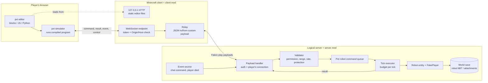

# Architecture plan: block/JS/Python robot programming for Minecraft Java

Date: 2026-11-09. Status: first draft; step-0 spike done. Changes from the spike are marked **(spike 2026-11-09)**. Builds on [makecode-java-mod-research.md](makecode-java-mod-research.md) (called "the report" below). Facts carry a source; anything not confirmed is marked **[UNVERIFIED]**. Numbers marked **(proposal)** are design choices, not measurements. Open items about the pxt editor and the Fabric and MakeCode API were researched on 2026-11-09 and are merged into the sections below.

Audience: hobby players who like coding or want to learn it. Singleplayer first, then ordinary friends/community servers. Not aimed at Minecraft Education or schools. License: MIT.

## 1. Decision summary

| Topic | Decision |
|---|---|
| Editor | A custom **pxt target** (microsoft/pxt, MIT), built with `pxt staticpkg` into static files and shipped inside the client mod. Gives blocks, JavaScript (Static TypeScript) and Python with round trip, like MakeCode. |
| Execution | **Program runs in the pxt simulator in the player's browser** and sends one command at a time. The server validates and executes each command on the server thread (section 2). |
| Browser link | Client mod runs a small HTTP + WebSocket server on `127.0.0.1`, serves the editor, and relays commands over the normal Minecraft connection (Fabric custom payloads). |
| Loader | Fabric and NeoForge (Minecraft 26.3, Java 25). Fabric is the main target with the full test suite; NeoForge since issue #187. |
| In-game browser (MCEF) | Not in v1. No 26.x build exists. |
| Robot | A custom server-side entity, one per player in v1, acting through a Fabric `FakePlayer` so protection mods see its edits. |

### Is a custom pxt target the right tool?

Yes. pxt documents target creation ([target-creation.md](https://github.com/microsoft/pxt/blob/master/docs/target-creation.md)): a target is a folder with `pxtarget.json`, `/libs` (APIs annotated as blocks), `/sim` (browser simulator) and `/docs`. Python is one flag, `appTheme.python: true`, as in [pxt-arcade](https://github.com/microsoft/pxt-arcade/blob/master/pxtarget.json) and [pxt-microbit](https://github.com/microsoft/pxt-microbit/blob/master/pxtarget.json). Blocks, JS and Python round trip comes with pxt; plain Blockly would need us to write the JS and Python converters ourselves.

Cost: pxt is a large TypeScript toolchain (Node build, its own compiler and webapp); the documented template [pxt-sample](https://github.com/microsoft/pxt-sample) is stale (pxt-core 7.4.21, last push 2023-03-18) while pxt-core is at 13.3.1, so the step 0 spike must rebuild the template on current pxt using the active targets as reference. A web-only target needs no C++/hardware compile (`nativeType`) work. MakeCode branding must be stripped from the theme (trademarks, report section 2).

## 2. Execution model

| | A. Editor/simulator runs the program, sends commands (MakeCode model) | B. Program runs on the server (CC: Tweaked model) |
|---|---|---|
| Where code runs | Browser, inside the pxt simulator. pxt already compiles blocks/JS/Python to JavaScript and runs it there. Simulator functions that return a Promise suspend the user program until resolved (`fooAsync` becomes `//% promise`, [simshim docs](https://github.com/microsoft/pxt/blob/master/docs/simshim.md)). pxt-sample ships a turtle with `forwardAsync`/`turnAsync` ([sim/api.ts](https://github.com/microsoft/pxt-sample/blob/master/sim/api.ts)). | Server JVM. Needs JS and Python interpreters in Java (QuickJS4J, GraalJS, Rhino for JS; a good MIT-compatible embeddable Python is **[UNVERIFIED]**), plus our own instruction budget. |
| Safety | Server only sees a small, typed command set it validates. No user code on the server, so no sandbox escape and no CPU exhaustion from infinite loops. Abuse is limited to "many valid commands", handled by rate limits. | Server must sandbox two languages, bound CPU and memory per program, and keep that safe across interpreter upgrades. Largest risk surface. |
| Latency | One round trip per action: browser to local relay (sub-ms), relay to server (player ping), result back. Every action already costs at least one tick (report section 4), so ping is hidden on LAN and adds roughly one ping per action on remote servers. | Lowest: in-JVM call. |
| Tab closed | Program stops. Server sees the heartbeat stop, finishes the current action and idles the robot. Same as MakeCode. | Program keeps running while the chunk is loaded. Surviving restarts needs a persisted VM (hard). |
| Multiplayer | Each player's own CPU runs their program. Server cost scales with commands, not user code. | Every running program costs server CPU. Friends' servers are often small. |
| Blocks/JS/Python round trip | Free from pxt; what runs is exactly what the editor shows. | Same semantics must exist on the server too, or programs drift. |
| Reuse | pxt simulator, stop/restart and console come for free. | Run/stop/step UI must be built. |

**Decision: A.** It matches MakeCode, reuses what a pxt target already does (compile and run in the browser simulator), keeps arbitrary user code off the server, and costs nothing per idle program. The price is that programs stop when the tab closes and remote servers add ping per action; both are acceptable for hobby use. The server still treats every command as untrusted input. Option B can return later as "upload a finished program to the robot" for long-running farms, but not in v1.

## 3. Components and data flow

| Component | Runs where | Job |
|---|---|---|
| **Editor (pxt target)** | Browser tab, served by the client mod at `http://127.0.0.1:<port>/` | Blocks/JS/Python editing, compile, simulator. The target's `sim` code implements API calls by sending JSON over a WebSocket to the relay and awaiting the result. In a `staticpkg` build the simulator is an iframe on the editor's own origin (`sandbox="allow-same-origin allow-scripts"`), so it reads the token from `localStorage` and may open the WebSocket directly; no postMessage bridge. |
| **Client mod (relay)** | Minecraft client (Fabric, client side) | Serves the static editor files and sets the CSP header; redirects `localhost` to `127.0.0.1`; WebSocket endpoint; token check; maps browser messages to Fabric custom payloads and back; opens the browser through a one-time launcher file (`/codeling`); shows run state in the HUD. Holds no game logic. |
| **Server mod** | Logical server (integrated server in singleplayer, dedicated server in multiplayer) | Owns robots. Validates each command (owner, permission, range, loaded chunk, protection, rate), queues it, executes on the server tick, returns a result. Emits events (chat command, player died via `ServerLivingEntityEvents.AFTER_DEATH`, filtered on the owner). Persists robot state. |
| **Robot entity** | Server world, synced to clients for rendering | Position, facing, 27-slot inventory, assists such as place-on-move. Acts in the world through a per-robot `FakePlayer` ([Fabric `FakePlayer`](https://github.com/FabricMC/fabric-api/blob/26.3/fabric-events-interaction-v0/src/main/java/net/fabricmc/fabric/api/entity/FakePlayer.java)) so block break/place events and claim mods apply. |

Client and server logic ship in one jar. Singleplayer uses both halves in one process.

The code is split into Gradle subprojects after jaredlll08's MultiLoader-Template (issues #185 and #186):

- `:core` is plain Java with no Minecraft or loader imports: the protocol decoder and encoder, heartbeat bookkeeping, the command validator (`RobotCommand`), block and item ids, shapes, and the relay (a small HTTP and RFC 6455 WebSocket server on `java.net`, which also runs standalone). `core`'s main code compiles with `--release 17` and the relay needs nothing beyond `java.base`, Gson and SLF4J, so it runs on every planned Minecraft version whatever Netty the game ships (issue #188); `:core:relayCompatTest` proves it on Java 17 and 21 with the Gson and SLF4J of 1.20.1 and 1.21.1 and no Netty. `:core:checkPureImports` keeps it free of `net.minecraft`, `com.mojang`, `net.fabricmc`, `net.neoforged` and `net.minecraftforge`.
- `:common` is vanilla Minecraft code shared by every loader: robot entity, queue, path search and tick executor (`RobotManager`), `/robot` commands, crafting, camera rules, the server end of the relay, payload types, and on the client the relay start, screen, renderer, camera and its mixins (`codeling.mixins.json`), plus `assets/`. It compiles against plain vanilla 26.3 through ModDevGradle in NeoForm mode (as the template does), so no loader API is on its classpath; `:common:checkCommonImports` also fails on a loader import. It has `main` and `client` source sets like Loom's split environment. Members that vanilla keeps private and the loaders open (the `MenuType` constructor) are opened for compiling with `META-INF/accesstransformer.cfg`. `RobotQueue`, `RobotPath` and `RobotTrail` stay here, not in `core`: they hold and return `BlockPos` and `Direction` (queue entries keep block iterators, the path search walks with `BlockPos.relative`), so moving them means a position type of our own through `RobotManager` and the GameTests.
- `:fabric` is the loader module: `fabric.mod.json`, the entrypoints `codeling.fabric.CodelingFabric` and `codeling.fabric.client.CodelingFabricClient`, and `FabricPlatform`/`FabricClientPlatform`. It compiles `common`'s sources into its own classes (template style), copies the core classes in, and so ships one jar. JUnit tests and all GameTests live here (the GameTests use Fabric's `@GameTest` and `FakePlayer`).
- `:neoforge` is the second loader module (issue #187, ModDevGradle, after the template's `neoforge` module): `neoforge.mods.toml` (lists `codeling.mixins.json` and `common`'s access transformer, which ModDevGradle also applies at compile time), the entrypoints `codeling.neoforge.CodelingNeoForge` and `codeling.neoforge.client.CodelingNeoForgeClient` (`@Mod(dist = CLIENT)`, since NeoForge has no split source sets), and `NeoForgePlatform`/`NeoForgeClientPlatform`. It compiles the sources of `core` and `common` into its own classes, so in a dev run too the relay, which loads `codeling-editor/` through its own class loader, sits in the same class loader as the editor files. Eight smoke GameTests (`src/gametest`, registered with `RegisterGameTestsEvent`, structure `codeling:gametest_empty`) run with `runGameTestServer` as part of `check`; `runClientSmoke` starts the client once and checks the mixins and the relay.

The platform layer is two small interfaces in `common`, found with `ServiceLoader` (`META-INF/services` in the loader module). `Platform`: `register` (registry entries as suppliers, so NeoForge can use `DeferredRegister`), `booleanRule`, `intRule`, `enumRule` (game rules), `fakePlayer`, `isFakePlayer`, `canSend` and `send` (server to client payloads). `ClientPlatform`: `canSend` and `send` (client to server). Events go the other way: each loader's entrypoint subscribes to its own events and calls the hooks in `codeling.Codeling` (`serverTick`, `serverStopped`, `playerLeft`, `entityLoaded`, `entityUnloaded`, `chat`, `died`), `ServerRelay.receive`, `RobotCommands.register`, and on the client `CodelingClient` and `RobotCameraClient` (start, stop, payloads, tick, HUD, level extraction, keys). How each loader does it:

| Platform method | Fabric | NeoForge |
|---|---|---|
| `register` | `Registry.register` at once | one `DeferredRegister` per registry on Codeling's mod event bus; the supplier is the `DeferredHolder` |
| `booleanRule`, `intRule` | Fabric API `GameRuleBuilder` | `new GameRule<>(...)` with vanilla's arguments for `GameRuleType.BOOL`/`INT`, registered like any entry |
| `enumRule` | `GameRuleBuilder.forEnum` | `GameRuleType` is extensible on NeoForge: `enumextensions.json` adds `CODELING_ENUM`, the argument is NeoForge's `EnumArgument`, the value is saved as the constant name (as on Fabric) and the Edit Game Rules screen shows NeoForge's generic text field |
| `fakePlayer`, `isFakePlayer` | Fabric `FakePlayer.get` | `FakePlayerFactory.get`, `instanceof FakePlayer` |
| `canSend`, `send` | `ServerPlayNetworking` | `connection.hasChannel`, `PacketDistributor.sendToPlayer`; payloads registered `optional()` in `RegisterPayloadHandlersEvent`, the client handlers in `RegisterClientPayloadHandlersEvent` |
| `ClientPlatform` | `ClientPlayNetworking` | `connection.hasChannel`, `ClientPacketDistributor.sendToServer` |

Events on NeoForge: `ServerTickEvent.Post`, `ServerStoppedEvent`, `PlayerLoggedOutEvent`, `EntityJoinLevelEvent` (lowest priority, server levels) and `EntityLeaveLevelEvent`, `ServerChatEvent` and `LivingDeathEvent` (lowest priority), `BreakBlockEvent` (lowest priority; `BlockEvent.BreakEvent` before 26.1), `RegisterCommandsEvent`; on the client `EntityRenderersEvent.RegisterRenderers`, `RegisterMenuScreensEvent`, `RegisterKeyMappingsEvent` (the Codeling key category is added by vanilla's `KeyMapping.Category.register` in `RobotCameraClient`, so it is not registered twice), `RegisterGuiLayersEvent`, `ClientTickEvent.Pre`, `ExtractLevelRenderStateEvent`, `ClientStartedEvent`/`ClientStoppingEvent` (relay), `ClientPlayerNetworkEvent.LoggingOut` and `RegisterClientCommandsEvent` (`/codeling`).

More versions and loaders are planned in stages: Fabric and NeoForge on 26.3 first (same Java 25, same unobfuscated game, so NeoForge is a new loader rather than a new version), then 1.21.1 on both, and 1.20.1 only if wanted. The code splits into a pure-Java `core` module plus per-loader modules; Forge on 26.x is not planned.

### Several Minecraft versions

Issue #189 adds Minecraft 1.21.1 (Fabric and NeoForge 21.1, Java 21) next to 26.3 from the same sources, with [Stonecutter](https://stonecutter.kikugie.dev/) 0.10 (`settings.gradle.kts`, controller `stonecutter.gradle.kts`) and [loom-back-compat](https://github.com/stonecutter-versioning/loom-back-compat) 0.4.3. Why Stonecutter and not a module per version: one file per class, the version differences sit next to each other and a reader sees both; the 26.3 build compiles `src/` as it is, so 26.3 cannot change by accident.

- Gradle projects: `:common:<v>`, `:fabric:<v>` and `:neoforge:<v>` for v in 26.3, 26.2, 26.1.2, 1.21.11, 1.21.10, 1.21.8, 1.21.5, 1.21.4, 1.21.3 and 1.21.1 (issues #206 to #213 add the 1.21.x and 26.x versions in between), in `<module>/versions/<v>/`, each run by its module's `build.gradle.kts`. What differs per version is in `<module>/versions/<v>/gradle.properties`: NeoForm, Fabric API and NeoForge versions, the Java version (25 or 21) and the metadata ranges (`~26.3`/`~1.21.1` in `fabric.mod.json`, `[26.3,26.4)`/`[1.21.1,1.21.2)` in `neoforge.mods.toml`). A project named for a patch version covers the patch versions before it with the same API, built against the last one because NeoForge has stable releases only there: 26.1.2 has `>=26.1 <26.2` and `[26.1,26.2)`, and its optional `neoforge_range` (`[26.1.0,)`) lets the jar accept the NeoForge line of each of them; without it the range is the built NeoForge version or newer. `:core` stays one project on Java 17.
- `src/` holds the 26.3 code (`stonecutter active "26.3"`, keep it so in git). For every other version Stonecutter writes a preprocessed copy to `<module>/versions/<v>/build/generated/stonecutter/`; the loader modules compile `common`'s copy for their version.
- Differences are Stonecutter conditions in comments, with the 26.x line active, for example in `McCompat.level`:
  ```java
  //? if >=1.21.9 {
  return player.level();
  //?} else
  /*return player.serverLevel();*/
  ```
  The condition names the version where the change came (1.21.11 for `Identifier` and the game rule rewrite, 1.21.5 for GameTests, 1.21.2 for render states and `getValue`, 26.3 for the level render state's player part and `Prediction`, 26.2 for `EntityTypes`, `getOwnSignal`, `gui.hud` and the name tag call without camera distance, 26.1 for `BlockModelResolver`, `submitNameDisplay` and the server-wide game rules and saved data). 1.21.10 and 1.21.8 showed: 1.21.9 for the op list's `NameAndId`, `KeyMapping.Category`, the `GameProfile` record, the submit pipeline (`SubmitNodeCollector`; 1.21.2 to 1.21.8 draw in `render()` from the render state), the GUI outline `submitOutline` (1.21.11 renamed it back to `renderOutline`) and `GameTestHelper.fail(String)`; 1.21.6 or earlier for `ServerPlayer.level()` returning `ServerLevel` and NeoForge's `ClientPacketDistributor`; 1.21.5 to 1.21.10 take an assert's message only as a `Component` (`GameTestAsserts`, through a string replacement) and list a test environment's game rules in `bool_rules` and `int_rules` (`fabric/build.gradle.kts` converts the JSON); 1.21.5 saves an entity to a `CompoundTag` with the `ValueInput` style getters (`getIntOr`, codec `read`/`store`) and without the UUID methods, so `RobotEntity` has a third branch. 1.21.4 showed that NeoForge's old `GameRules.Type` takes the rule's `Class` from 1.21.5 (its `FeatureFlagSet` is older), and 1.21.3 that `PlacementInfo.slotsToIngredientIndex` came with 1.21.4 (1.21.2 and 1.21.3 use `slotInfo`). Every target from 1.21.1 to 26.3 is now built, so each boundary sits between two built versions; a change inside a group of versions that share a jar is named by the group's first version (1.21.2 for the 1.21.3 jar, 1.21.6 for 1.21.8, 1.21.9 for 1.21.10, 26.1 for 26.1.2). Pure renames are string replacements in `stonecutter.gradle.kts`, which Stonecutter also runs backwards for a version where the condition is false: a rename between two names that both exist in some version breaks that version (from 26.2 on both `EntityTypes` and `EntityType` exist, so only `EntityTypes.PIG` and `.ZOMBIE` are renamed). Examples: `Identifier` to `ResourceLocation`, `GuiGraphicsExtractor` to `GuiGraphics`, `.snapTo(` to `.moveTo(`, Fabric's `@GameTest(maxTicks = ...)` to vanilla's `@GameTest(template = ..., timeoutTicks = ...)`. Calls that differ in many places go through `codeling.McCompat` (common) and `codeling.gametest.GameTestCompat` (Fabric GameTests), so the robot code reads the same on every version.
- Fabric 1.21.1 uses `fabric-loom-remap` (Mojang's mappings in development, an intermediary jar from `remapJar`); 26.x uses `fabric-loom` (unobfuscated). loom-back-compat picks the right one per version.
- Metadata files are expanded per version: `codeling.mixins.json` (compatibility level `JAVA_21` or `JAVA_25`; versions before 26.3 add `GameRendererMixin`, which hides the hand while the robot camera is on, since their level render state has no player part), `neoforge.mods.toml` (`enumextensions.json` on 26.x, a second access transformer on 1.21.1).

What 1.21.1 does differently, by area:

| Area | 26.3 | 1.21.1 |
|---|---|---|
| Game rules | `GameRule` registry entries (`GameRuleBuilder` on Fabric, `new GameRule<>` with the `CODELING_ENUM` type on NeoForge) | `GameRules.Key` named by the id string, `codeling:free_items`. Fabric: `GameRuleRegistry` with `GameRuleFactory.createEnumRule`. NeoForge: `GameRules.register`, the int range through vanilla's ranged `IntegerValue.create`, and `codeling:robot_camera` as an own `GameRules.Value` with NeoForge's `EnumArgument`; the members are opened by `META-INF/accesstransformer-gamerules.cfg`. The enum value is saved as the constant name on every version and loader. Read through `Codeling.freeItems/maxRobots/robotCamera`. |
| Saved robot data | `ValueInput`/`ValueOutput`, `data/codeling/robots.dat` | `CompoundTag` with the same keys, `data/codeling_robots.dat` (1.21.5 to 1.21.11 also use this file name: their `SavedDataType` id is a file name). 26.x reads it once when `data/codeling/robots.dat` is missing, so a world moved from 1.21.x keeps its robots |
| Crafting | recipe displays, `StackedItemContents` | `getResultItem`, `StackedContents`, whose answer has one id per grid slot (0 for an empty one) |
| Client | level render state, `GuiGraphicsExtractor`, `KeyMapping.Category` | `GameRendererMixin`, `GuiGraphics`, a category translation key; NeoForge 21.1 starts the relay on the first client tick (no `ClientStartedEvent`) and gets the client payload handlers at registration (no `RegisterClientPayloadHandlersEvent`) |
| Fabric API | `PayloadTypeRegistry.serverboundPlay`, `KeyMappingHelper`, `HudElementRegistry` | `playC2S`, `KeyBindingHelper`, `HudRenderCallback`, `EntityRendererRegistry` |
| GameTests | Fabric's `@GameTest` with test environments; NeoForge test registries | vanilla `@GameTest` with Fabric's empty structure, a test environment becomes a batch with `@BeforeBatch`; NeoForge: a `@GameTestGenerator` in a `@GameTestHolder`. No client GameTest API: `runClientSmoke` instead |

Blocks and items: `BlockIds` and `ItemIds` are 26.3's tables on every version, so the editor (the same for all versions) offers 26.3's blocks and items, and a code means the same thing everywhere. The mod tells `ItemIds` which ids its registry has (`ItemIds.setInThisVersion` in `Codeling.init`), and the command validator refuses the others with `BAD_ARGS` "minecraft:<id> is not in this Minecraft version". Items renamed since 1.21.1 map back in `McCompat.itemId` (26.3's `iron_chain` is 1.21.1's `chain`). Every block code is in 1.21.1 (the legacy ids are old); the 1.21.1 GameTests check both tables against the registry.

Jar names: `<modid>-<loader>-<minecraftversion>-<modversion>.jar`, all lowercase, loader `fabric`, `neoforge` or `forge` (for example `codeling-fabric-26.3-0.0.1.jar` or `codeling-neoforge-1.21.1-0.0.1.jar`; a sources jar adds `-sources`). The mod name comes first so the files sort together in a mods folder, then loader and Minecraft version so a player sees at a glance which file to pick, then the mod version. The name comes from `mod_id` and `mod_version` in `gradle.properties`, the module name as loader part and the Stonecutter project's name as Minecraft version, in `gradle/loader.gradle.kts`, which every loader module applies; its `checkJarNames` fails the build on a jar that breaks the rule. The version in the loader metadata stays the plain mod version.



### Message protocol (v1)

JSON over the WebSocket; the same fields inside one Fabric payload type per direction (`PayloadTypeRegistry` and `ServerPlayNetworking` in [fabric-networking-api-v1](https://github.com/FabricMC/fabric-api/tree/26.3/fabric-networking-api-v1)). Every message has `v` (protocol version) and `t` (type).

| Type | Direction | Fields | Notes |
|---|---|---|---|
| `hello` | browser to relay | `token`, `client` (target version) | First message. Relay closes the socket on bad token or version. |
| `welcome` | relay to browser | `player`, `robot`, `limits`, `server` (protocol version) | Limits let the editor warn early. |
| `control` | both | `op`: `start`, `stop`, `pause`, `resume`, `heartbeat`, `subscribe`, `notice`; `run` (run id) | `start` gets a fresh run id from the server; all later commands carry it. `notice` (client mod to browser, `run` -1, issue #192) carries a `message` the editor logs and the program goes on: the singleplayer game was paused (its commands wait) or runs again. `subscribe` (browser to server, issue #27) carries `chat` (the program's `onChat` keywords) and `died` (true with an `onDied` handler) for the current run, and since issue #89 `broken` (the block codes of its `onBlockBroken` handlers, at most 16 known blocks, not air), `redstone` and `dayStart` (true with such a handler); all fields are optional, so an older editor's message still fits, and an older server ignores the new ones; each one replaces the one before, and one for an ended run gets `STOPPED`. An older server ignores `subscribe`, so no version change. |
| `cmd` | browser to server | `id` (per-run counter), `run`, `op` (for example `agent.move`), `args` (typed values), `robot` (optional name, protocol v2) | One outstanding `cmd` per robot; the sim awaits the result. Without `robot` the command goes to the sender's default robot; with it, to the sender's robot of that name (never someone else's). `control` `stop`, `pause` and `resume` also take an optional `robot` to act on one robot's queue. |
| `result` | server to browser | `id`, `ok: true`, `value`, `message` (optional) | `value` for queries (`inspect`, `getPosition`, `detect`). `message` says in plain words why an action did less than asked (a build that ran out of blocks); the editor writes it to its log. |
| `error` | server to browser | `id` (if tied to a command), `code`, `message` | Codes: `BAD_ARGS`, `NO_PERMISSION`, `RATE_LIMITED`, `PROTECTED`, `UNLOADED`, `OUT_OF_RANGE`, `STOPPED`, `VERSION`. Actions that simply fail (blocked path) return `ok: true, value: false`, as CC: Tweaked does (report section 4). Errors are for rule violations. The sim throws an error tied to a waiting command into the program as the text `CODE: message`, where `try`/`catch` can catch it (issue #218); `STOPPED`, `VERSION` and errors without an `id` end the run with a dialog. |
| `event` | server to browser | `name` (`chat`, `playerDied`, `blockBroken`, `redstonePowered`, `dayStart`), `args` | Only for handlers the program subscribed to, and only for its owner's own chat lines, death and broken blocks, its owner's default robot and its owner's dimension (issues #27, #89). `chat` args: the matched keyword (the line's first word, or `*`) and three numbers; `blockBroken` args: the block code; the others: none. |

### Auth and token flow

Basis: pxt's own local-token mechanism.

1. The client mod starts the HTTP/WebSocket server bound to `127.0.0.1` only, on a fixed configurable port. If the port is busy it fails with a clear in-game error and never falls back to a random port: pxt keeps projects in IndexedDB per origin, so a changed port or host hides them (section 6). Requests with Host `localhost:<port>` get a redirect to `127.0.0.1:<port>` so the origin never splits.
2. Per game session the mod generates a token with `SecureRandom` (at least 128 bits, URL-safe encoding). It lives in memory only on the mod side: never logged, never written to config.
3. `/codeling` opens `http://127.0.0.1:<port>/#local_token=<token>`, but never by putting that URL in a command line (issue #191): `xdg-open`, `open`, `rundll32` and the browser would carry it in argv, which other local users can read with `ps`. Instead `EditorLauncher` (core) writes a one-time page `open.html` into a new `codeling-editor-*` directory under the user's temp directory and the game opens that file, so argv holds only a path. The page goes to the editor URL with `location.replace` (no history entry), a `<meta http-equiv="refresh">` and a link as fallbacks, so the browser lands exactly where the old URL did. Only the user can read it: on POSIX the directory is created 0700 and the file 0600 (set at creation, not afterwards); on Windows the directory, still empty, gets an ACL with one entry for its owner, which the file inherits. The file is created new, so one planted first fails the launch. It is deleted 60 s after opening, all launchers are deleted at client start and shutdown, and the token is never logged. A navigation from the `file:` page is a plain top-level GET: the relay checks `Host` on it and `Origin` only on the WebSocket upgrade, which the editor makes from its own origin. Snap and Flatpak browsers on Linux cannot read `/tmp`, so the chat line `/codeling` prints has a link that copies the editor URL to the clipboard (never into argv) for pasting into the address bar. This is pxt's built-in name: the editor moves it from the hash into `localStorage["<targetId>/local_token"]` and strips it from the address bar. A URL fragment is not sent to servers or in Referer headers. The sim (same origin) reads the key with `localStorage.getItem` and sends it in `hello`. It persists in `localStorage` across browser restarts, which is harmless because each game session issues a new token.
4. A WebSocket upgrade is accepted only if `Host` is `127.0.0.1:<port>` (DNS rebinding defence) and `Origin` equals the editor's own origin (cross-site defence). Then `hello.token` must match (constant-time compare).
   - Limits of the hand-written server (issue #188, `RelayHardeningTest`): request head at most 16 KiB (431), a repeated `Host` or `Origin` is a 400, a request head and the `hello` on a new relay socket must arrive within 10 s (slowloris), and so must each response and each frame be written (else the socket closes), at most 64 connections, only bodiless `GET` and `HEAD` (a request with `Content-Length` over 0 or `Transfer-Encoding` is a 400, other methods a 405), static paths with `..`, `\` or NUL are a 400, a directory is a 404, static files are streamed. The `localhost` redirect is for `GET` and `HEAD` only, after the path check, and closes the connection. Every response has `frame-ancestors 'self'`, `X-Frame-Options: SAMEORIGIN` and `Referrer-Policy: no-referrer`. WebSocket: version 13 only (426 otherwise), the client must mask its frames (close 1002), a frame over 8 KiB closes with 1009, binary and fragmented messages with 1003, invalid UTF-8 with 1007, reserved opcodes, continuations, bad close codes and a 64-bit length with the top bit set with 1002, no extensions. Before the `hello` only the `hello` is accepted: a ping or pong closes with 1008. Each session has its own writer thread, and one that leaves more than 256 KiB unread is closed, so a browser that does not read never holds up the game or another session.
5. Our HTTP server sets `Content-Security-Policy` with `connect-src 'self' ws://127.0.0.1:<port>`, since pxt sets none. This also stops the editor calling makecode.com or other hosts. **(spike 2026-11-09)** The CSP alone is not enough: pxt's `apptracking.html` include puts an Application Insights snippet (Microsoft's key, posting to `dc.services.visualstudio.com`) into every static `index.html`. The target overrides it with an empty `docfiles/apptracking.html`, and the theme sets `@importGoogleFonts: false`. With both, the editor makes zero external requests in Chrome, Edge and Firefox. Working CSP: `default-src 'self'`, `script-src 'self' 'unsafe-inline' 'unsafe-eval' blob:`, `style-src 'self' 'unsafe-inline'`, `img-src`/`font-src`/`media-src` adding `data:` (and `blob:`), `worker-src`/`frame-src 'self' blob:`.
6. The server never sees the token. It authenticates by the player's game connection: a payload from player P can only control P's robot. Ops control other robots through server commands, not payloads.
7. User programs run in the same sim frame and could read the token. They can only call declared APIs and server-side validation is the real boundary (section 7).

### Tick model and run control

- The server keeps a FIFO per robot. Each tick the executor walks robots round-robin and runs at most one action per robot within a global action budget (section 8). Leftover work waits for the next tick.
- Each action takes at least 1 tick; `move` takes a configurable number of ticks per block (default 4, proposal) so movement is visible.
- `start`: server issues a run id and clears the robot queue. `stop` (editor stop button, `/robot stop`, disconnect, or 10 s without heartbeat, proposal): server drops the queue, rejects commands with the old run id (`STOPPED`), and tells the browser so the sim halts. `pause`/`resume`: server holds the queue; the sim stays blocked on its pending `await`, so the program pauses without needing the pxt debugger.
- The pxt debugger (breakpoints, Step, Variables, slow motion) works with these async robot commands: see [debugging.md](debugging.md) (issue #217).
- Chat-command events (as planned): a `ServerMessageEvents.ALLOW_CHAT_MESSAGE` listener ([fabric-message-api-v1](https://github.com/FabricMC/fabric-api/tree/26.3/fabric-message-api-v1); parameters `PlayerChatMessage`, `ServerPlayer`, `ChatType.Bound`) checks whether the sender has a running program with an `onChat` keyword equal to the first word of the line (or `*`). If so it parses the numbers, returns `false` (the line is not broadcast), and queues `event chat` for that player only. Never rewrite the message. A fallback command `/<modname> chat <text...>` registered through `CommandRegistrationCallback` ([fabric-command-api-v2](https://github.com/FabricMC/fabric-api/tree/26.3/fabric-command-api-v2)) covers servers with chat plugins, command blocks and keybinds, and is permission-checkable. Chat events are marshalled onto the tick queue; the listener thread is assumed, not confirmed, to be the server thread.
- Chat and death events as built (issue #27): Fabric's `ALLOW_CHAT_MESSAGE` (chat type `chat` only, so not `/say` or `/me`) and NeoForge's cancellable `ServerChatEvent` both call `Codeling.chat(player, text)` with the raw line (`PlayerChatMessage.signedContent()`, `getRawText()`). `PlayerEvents` checks whether the sender has a run that is current right now and subscribed to the line's first word (or `*`); only then is the line held back (`false`, or the event cancelled) and `event chat` with the keyword and the numbers (`ChatCommands`, JavaScript `parseInt`) queued for that player's own editor. Every other line is broadcast untouched, and no line is rewritten. Both events run on the server thread, checked in the 26.3 and 1.21.1 sources (`ServerGamePacketListenerImpl.tryHandleChat` runs the handler through `server.execute`, and the broadcast is chained on the server executor); `Codeling.chat` holds nothing back off that thread. Events wait in a queue per player (at most 16, more are dropped) and go out one per tick, only while the run that subscribed is current. A run that ends loses its subscription at once: Stop, a new run, the heartbeat timeout, leaving and server stop remove it, and a run stopped in the game (`/robot stop`, `/robot stop all`) is noticed on the next tick, which also sends `control stop` to the editor, since a program with only handlers has no command waiting that would learn it. `/codeling chat <text>` (server command, no permission needed, it only reaches the caller's own program) does the same for servers with chat plugins and says so when nothing listens. The Fabric client's `/codeling` command knows `chat <text>` without running it, because Fabric passes a line to the server only on "unknown or incomplete command". Deaths: Fabric's `ServerLivingEntityEvents.AFTER_DEATH` and NeoForge's `LivingDeathEvent` (lowest priority, not when cancelled) call `Codeling.died`, which queues `event playerDied` for the dead player's own subscribed run.
- Block broken, redstone and day start events as built (issue #89): Fabric's `PlayerBlockBreakEvents.AFTER` (server side, the block already gone; a break refused in `BEFORE` never gets there) and NeoForge's `BreakBlockEvent` (`BlockEvent.BreakEvent` before 26.1; fired before the block goes, so lowest priority and not when cancelled) both call `Codeling.blockBroken(player, state)`, which never changes or cancels the break. Only a real `ServerPlayer` on the server thread counts, never a FakePlayer: the robot's carries its owner's UUID. `PlayerEvents` queues `event blockBroken` with the block's code when the breaker's current run listens for it. Redstone and the day start need no loader event: on the server tick, only for a current run that subscribed, `PlayerEvents` reads the power at the default robot's own block (`RobotManager.redstonePower`, the same value as `agent.redstonePower`), only while the robot is loaded, and the owner's time of day (`McCompat.dayTime` of the owner's level, modulo 24000). `redstonePowered` goes on a rising edge (0 to more; a robot powered when the program subscribes gives none), `dayStart` when the time of day is lower than on the tick before. All three share the per-player queue of 16 and the one-per-tick pace with chat and death, and end with the run in the same way.

## 4. Dependencies (checked 2026-11-09)

| Name | Version | License | Link | Status |
|---|---|---|---|---|
| Minecraft Java | 26.3 (released 2026-09-15); snapshot 26.4-snapshot-7 | Proprietary (EULA) | [Mojang version manifest](https://piston-meta.mojang.com/mc/game/version_manifest_v2.json) | OK. Target version. |
| Java runtime | 25 (`javaVersion.majorVersion` in the 26.3 version JSON) | GPL-2.0 with Classpath Exception (OpenJDK) | same manifest | OK |
| Fabric Loader | 0.20.1 (2026-10-19), marked stable | Apache-2.0 | [GitHub](https://github.com/FabricMC/fabric-loader), [Fabric meta](https://meta.fabricmc.net/v2/versions/loader) | OK. Fabric meta lists 26.3 as a stable game version. |
| Fabric API | 0.165.2+26.3 (2026-11-03) | Apache-2.0 | [GitHub](https://github.com/FabricMC/fabric-api), [Modrinth](https://modrinth.com/mod/fabric-api) | OK. Branch 26.3 has `fabric-events-interaction-v0` (`net.fabricmc.fabric.api.entity.FakePlayer`, use the owner UUID plus a distinct name per robot, never cache across level unloads), `fabric-networking-api-v1` (payloads), `fabric-gametest-api-v1`, `fabric-client-gametest-api-v1`, `fabric-permission-api-v1`, `fabric-message-api-v1` (chat), `fabric-command-api-v2` (fallback command), `fabric-entity-events-v1` (`AFTER_DEATH`), `fabric-data-attachment-api-v1`. |
| Fabric Loom | 1.19 (2026-10-23); pinned 1.19.4 **(spike 2026-11-09)** | MIT | [GitHub](https://github.com/FabricMC/fabric-loom) | OK. Plugin id `net.fabricmc.fabric-loom`, no mappings line on 26.x per the [porting guide](https://docs.fabricmc.net/26.1.2/develop/porting/) (report section 6). **(spike 2026-11-09)** Loom 1.19.4 needs the Gradle daemon itself on Java 25; the repo uses Gradle 9.8.2 with `gradle/gradle-daemon-jvm.properties` (foojay auto-provisioning), so an installed Java 21 can start the wrapper. |
| NeoForge | 26.3.0.102 (non-beta builds since 26.3.0.76) | LGPL-2.1 | [maven metadata](https://maven.neoforged.net/releases/net/neoforged/neoforge/maven-metadata.xml), [GitHub](https://github.com/neoforged/NeoForge) | OK, stable for 26.3. We only link against it. Used by `:neoforge` (issue #187, `neoforge_version` in `gradle.properties`). |
| pxt-core (microsoft/pxt) | npm 13.3.1 (2026-11-05); repo pushed 2026-11-06 | MIT | [GitHub](https://github.com/microsoft/pxt), [npm](https://www.npmjs.com/package/pxt-core) | OK, very active. Target creation is documented. |
| pxt-common-packages | npm 14.2.1 (2026-09-24) | MIT | [GitHub](https://github.com/microsoft/pxt-common-packages) | OK. Probably only base libs needed. |
| pxt-sample (template target) | npm 1.0.17 (2017); repo pushed 2023-03-18; pins pxt-core 7.4.21 | MIT | [GitHub](https://github.com/microsoft/pxt-sample) | **Stale.** Still the documented template but 6 majors behind. Use as a guide only. |
| Reference targets | pxt-arcade 4.2.1, pxt-microbit 9.1.2 | MIT (npm metadata; microbit's GitHub shows NOASSERTION because of THIRD-PARTY-NOTICES, its LICENSE.txt is MIT) | [pxt-arcade](https://github.com/microsoft/pxt-arcade), [pxt-microbit](https://github.com/microsoft/pxt-microbit) | OK, active. Structure reference, not dependencies. |
| Blockly (as used by pxt) | pxt master depends on upstream `blockly` 13.1.1 plus `@blockly/*` plugins; latest Blockly 13.4.0 (2026-10-13) | Apache-2.0 | [pxt package.json](https://github.com/microsoft/pxt/blob/master/package.json), [Blockly](https://github.com/RaspberryPiFoundation/blockly) | OK. Ship Blockly's LICENSE and NOTICE text. |
| pxt-blockly | npm 4.0.15 (2022-07-12); only maintenance commits since 2022 | MIT plus upstream Blockly notices | [GitHub](https://github.com/microsoft/pxt-blockly) | **Superseded.** Current pxt no longer depends on it. Do not use. This corrects the report, which treated it as pxt's editor. |
| Monaco editor (bundled by pxt) | 0.24.0 as pinned in pxt package.json | MIT | [pxt package.json](https://github.com/microsoft/pxt/blob/master/package.json) | OK (old pin, managed by pxt). |
| TypeScript (target build) **(spike 2026-11-09)** | 4.8.3, the version pxt-core 13.3.1 depends on | Apache-2.0 | pxt-core package.json | OK. pxt runs the target's own `node_modules/typescript` for the sim. |
| HTTP/WebSocket in the client mod | **Since issue #188: none.** The relay is our own server on `java.net` (`java.base` only), because `netty-codec-http` ships with Minecraft only from 1.21.9 and Netty 4.2 only from 1.21.11. Before: Netty 4.2.16.Final. `netty-codec-http` is in the 26.3 client library list and in the dedicated server jar's `META-INF/libraries.list` (verified) | Apache-2.0 | [26.3 version JSON](https://piston-meta.mojang.com/v1/packages/80608ff6753705b6a82e2cb86a5937d4d233abd4/26.3.json) | **Use it for v1.** Not guaranteed long term (a Mojang implementation detail). Guards: runtime `Class.forName("io.netty.handler.codec.http.websocketx.WebSocketServerProtocolHandler")` at startup with a clear error; a CI job that fetches the manifest per supported MC version and greps the library list; fallback of JDK `com.sun.net.httpserver` for static files plus a shaded, relocated Java-WebSocket (MIT, [GitHub](https://github.com/TooTallNate/Java-WebSocket)). Compile against the shipped version. |
| Gson | 2.14.0, ships with 26.3 | Apache-2.0 | 26.3 version JSON | OK for message JSON. |
| MCEF | 2.1.6-1.21.4 (Modrinth, 2025-01-16); repo last pushed 2025-08-11 | LGPL-2.1 | [Modrinth](https://modrinth.com/mod/mcef), [GitHub](https://github.com/CinemaMod/mcef) | **No 26.x build; looks inactive.** Later option only. |

License compatibility: every dependency is MIT, Apache-2.0, or LGPL-2.1 for loaders we only link against. All are compatible with an MIT mod. Apache-2.0 parts we redistribute (Blockly inside the bundled editor, Fabric API modules if jar-in-jar) need their LICENSE/NOTICE in the jar. Netty and Gson are not redistributed. Microsoft's MakeCode name and logos are not covered by MIT.

**Licence warning (typings source).** The only complete source of MakeCode-for-Minecraft typings found is a GPL-3.0 repo containing Microsoft-authored text ([BrandonFOSSedu/MinecraftEDUtutorials](https://github.com/BrandonFOSSedu/MinecraftEDUtutorials), `core/`, Education Edition). It was used for reading names, signatures and numeric values only. Never copy its files or comments, or Microsoft's `Block` enum list, into this MIT repo; write our own declarations and constants. A permissive alternative (ProjectHSI/pxt-minecraft-types) holds no types. See section 5.

## 5. API spec v1

Names and casing follow MakeCode so programs from minecraft.makecode.com paste in. Python names are pxt's automatic snake_case (`set_item`, `run_chat_command`, seen in screenshot 13). Evidence codes:

- **V-HOC**: verified call in [pxt-minecraft-HOC2019](https://github.com/microsoft/pxt-minecraft-HOC2019/blob/master/extension.ts) (report section 3).
- **V-EX**: verified call in a Microsoft example repo (castle-builder, roller-coaster, pixel-art, space; links in section 9) or the live "Agent Pyramid" example (screenshots 11 and 13).
- **V-TYP**: verified (names, signatures, values) against the Education Edition core typings and Mojang's [EducationContent](https://github.com/Mojang/EducationContent) lessons. Read only; see the licence warning in section 4. Education Edition, not the Java target, but the agent/player/positions API is shared.
- **V-UI**: block seen in the live toolbox screenshots only.
- **INF**: inferred, still open.

### agent

| Signature | Evidence | Server behaviour |
|---|---|---|
| `agent.move(direction: SixDirection, blocks: number)` | V-EX, V-TYP | One block per step, cap 64 per call (proposal). Floats, but does not pass through solid blocks (a deliberate change from Bedrock, report section 4). Stops early if blocked. |
| `agent.turn(direction: TurnDirection)` | V-EX, V-TYP | 90 degrees. |
| `agent.teleportToPlayer()` | V-EX, V-TYP | To owner; same dimension only in v1. |
| `agent.teleport(pos: Position, facing: CompassDirection)` | V-EX, V-TYP | Limited to loaded chunks near the owner. |
| `agent.getPosition(): Position` | V-HOC | |
| `agent.getOrientation(): number` | V-TYP | Heading in degrees. Docs are inconsistent; the Bedrock yaw convention (0 south, 90 west, -90 east, +-180 north) equals Java `getYRot`. **Confirm in game** before fixing the convention. |
| `agent.setAssist(assist: AgentAssist, on: boolean)` | V-EX, V-TYP | v1 supports `PLACE_ON_MOVE` only. |
| `agent.place(direction: SixDirection)` | V-HOC | Places from the selected slot. |
| `agent.destroy(direction: SixDirection)` | V-HOC | Drops go to robot inventory (proposal). Unbreakable blocks stay unbreakable (change from Bedrock). |
| `agent.attack(direction)`, `agent.interact(direction)`, `agent.till(direction)` | V-HOC / V-TYP / V-TYP | `attack` hits mobs only; players only if server config allows (proposal). |
| `agent.detect(kind: AgentDetection, direction): boolean` | V-TYP | Kinds in the enum table below. |
| `agent.inspect(kind: AgentInspection, direction): number` | V-HOC, V-TYP | `Block` returns an encoded block id (see Block ids below); `Data` returns the data value. |
| `agent.setItem(blockOrItem, count, slot)` | V-HOC, V-EX | **Creative-style give.** Allowed when the owner is online and in creative, or when the gamerule `codeling:free_items` is true (default false). In survival the robot gathers its own resources. Items share the number space with blocks. |
| `agent.setSlot(slot)`, `agent.getItemCount(slot)` | V-HOC | Slots 1 to 27. |
| `agent.collectAll()`, `agent.collect(block)` | V-HOC / V-TYP | `collectAll`: items within 1 block. |
| `agent.getItemSpace(slot)`, `agent.getItemDetail(slot)`, `agent.transfer(quantity, sourceSlot, destinationSlot)`, `agent.drop(direction, slot, quantity)`, `agent.dropAll(direction)` | V-TYP | v1 if cheap, otherwise v1.1. `transfer` takes quantity first. |

Enums (values verified, V-TYP; we declare our own copies):

| Enum | Members |
|---|---|
| `SixDirection` | `FORWARD` 0, `BACK` 1, `LEFT` 2, `RIGHT` 3, `UP` 4, `DOWN` 5 (also global constants) |
| `TurnDirection` | `LEFT_TURN` 2, `RIGHT_TURN` 3 |
| `AgentAssist` | `PLACE_ON_MOVE` 0, `PLACE_FROM_ANY_SLOT` 1, `DESTROY_OBSTACLES` 2 (v1 implements `PLACE_ON_MOVE` only; the misspelled legacy duplicate is not carried over) |
| `AgentInspection` | `Block` 0, `Data` 1 |
| `AgentDetection` | `Block` 0, `Redstone` 1 |
| `CompassDirection` | `North` 0, `East` 1, `South` 2, `West` 4 (not 3) |
| `Axis` | `X` 0, `Y` 1, `Z` 2 |

### player

The built calls (issue #26) need no robot: `PlayerApi` answers them on the server tick about the sender only, one per owner per tick with at most `RobotQueue.MAX_LENGTH` (16) waiting, else `RATE_LIMITED`. An older server answers their ops with `BAD_ARGS` "unknown op", so no protocol version change.

| Signature | Evidence | Notes |
|---|---|---|
| `player.onChat(command: string, handler: (num1: number, num2: number, num3: number) => void)` | V-EX, V-TYP | Up to 3 numeric args: the words after the keyword, split on whitespace, each parsed with `parseInt`; non-numeric or missing become 0. Command `"*"` matches every message. **Built (issue #27):** a line runs the handlers of its first word and the `*` handlers. Keywords are one word of letters, digits, `-` and `_` (1 to 32 characters, case matters), at most 16 per run. Block "on chat command %command" with num1, num2 and num3 as draggable reporters (`optionalVariableArgs`). Delivery: section 3. |
| `player.say(message: string)` | V-TYP | **Built (issue #26).** **Deliberate deviation:** MakeCode's `say` is a public chat line; ours is a system message to the owner only, a literal component (no formatting, click or hover), control characters and the section sign turned into spaces, at most 256 characters. |
| `player.position(): Position` | V-EX | **Built (issue #26).** The owner's feet block, world coordinates. |
| `player.getOrientation(): number` | V-EX | **Built (issue #26).** The owner's yaw wrapped to -180 to 180, one decimal; the same convention as `agent.getOrientation`. |
| `player.name(): string` | V-TYP | **Built (issue #26).** |
| `player.runChatCommand(command: string)` | V-EX | **Built (issue #27).** Runs the program's own `onChat` handlers in the simulator only, as a chat line would (first word, then up to three numbers); sends nothing to the game, never vanilla commands. Waits until the handlers have finished. |
| `player.onDied(handler: () => void)` | V-TYP | **Built (issue #27).** No arguments. Server side: `ServerLivingEntityEvents.AFTER_DEATH` (NeoForge: `LivingDeathEvent`) filtered on the owner. |
| `player.teleport(pos)` | V-EX | **Built (issue #26).** Only for the host of a singleplayer world or an op at game master level (`McCompat.isGamemaster`), else `NO_PERMISSION`. Whole coordinates (the validator refuses NaN, infinity and fractions), resolved against the owner in the editor, in the owner's current dimension; outside the world border, the build height or vanilla's spawnable bounds is `OUT_OF_RANGE`. An offline owner gets `UNLOADED`. Game mode does not matter (as for `/tp`). |
| `player.execute(command)` | V-EX | **Not in v1** (section 7). |

### gameplay

Time and weather (issue #87), MakeCode's category for them. `PlayerApi` answers them like the player calls (no robot, one per owner per tick, at most 16 waiting, else `RATE_LIMITED`; an offline owner gets `UNLOADED`), for the owner's current dimension only. An older server answers `BAD_ARGS` "unknown op", so no protocol version change. `world` would have been the issue's name, but it is already MakeCode's global `world(x, y, z)` position function, so a `world` namespace would clash in JavaScript and Python.

| Signature | Evidence | Notes |
|---|---|---|
| `gameplay.timeOfDay(): number` | INF | **Built (issue #87).** Codeling extension: the time of day in ticks, 0 to 23999 (0 sunrise, 6000 noon, 12000 sunset, 18000 midnight), the Overworld's clock in every dimension as `/time query daytime` shows it. `Level.getDayTime()` before 26.1, `getOverworldClockTime()` from 26.1 (`McCompat.dayTime`). MakeCode reads the same value with `gameplay.timeQuery(TimeQuery.DayTime)`, which is not built. Standalone relay answers 6000. |
| `gameplay.isRaining(): boolean` | INF | **Built (issue #87).** Codeling extension: `Level.isRaining()` of the owner's dimension, rain or thunder (snow too), always false in the Nether and the End. Not whether rain falls on one block (`isRainingAt`, not built). MakeCode's nearest call is `gameplay.weatherQuery()` (clear, rain or thunder), not built. Standalone relay answers false. |
| `gameplay.onDayStart(handler: () => void)` | INF | **Built (issue #89).** Codeling extension; MakeCode has no day event. Runs when the time of day in the owner's dimension wraps round (lower than on the tick before): the night ending, sleeping, or `/time set` to an earlier time of day. `/time add 24000` keeps the time of day and gives none. No arguments. Delivery: section 3. |

The robot-side reads are in the agent API table of the README: `agent.lightLevel()` (0 to 15, `getMaxLocalRawBrightness` at the robot's block), `agent.biome()` (short id, `minecraft:` left out) and `agent.temperature()` (the biome's base temperature, two decimals). They go through the robot queue like the other sensors and read only the robot's own block, which is loaded while the robot is.

`agent.onRedstonePowered(handler)` (issue #89, Codeling extension, "on agent redstone powered") is in that table too: the default robot only, since named robots get each call through a `Robot` method and this one has none.

### blocks

| Signature | Evidence | Notes |
|---|---|---|
| `blocks.onBlockBroken(block, handler: () => void)` | V-HOC | **Built (issue #89).** MakeCode's name, arguments and block ("on %block broken"); the handler gets nothing. Only blocks the program's owner breaks by hand; never the robot's FakePlayer, never another player. At most 16 blocks per run. Delivery: section 3. |
| `blocks.place(block, pos)` | V-HOC | Creative-style; gated like `setItem`. |
| `blocks.testForBlock(block, pos): boolean` | V-HOC | Read-only, open to everyone. |
| `blocks.fill(block, from, to, operation: FillOperation)` | V-EX (`FillOperation.Replace`) | Gated. Volume cap 4096 (proposal). |
| `blocks.replace(newBlock, oldBlock, from, to)` | V-EX | Gated, same cap. |
| `Block.*` constants and globals (`SANDSTONE`, `AIR`, ...) | V-HOC, V-EX | See Block ids. |

**Block ids (verified, V-TYP).** `Block` is a numeric const enum, so programs hold plain integers: low 16 bits are the legacy (pre-flattening) block id, the data value sits above, `id | data << 16` (for example `Air = 0`, `Stone = 1`, `Sandstone = 24`, `Granite = 1 | 1 << 16`). The server mod needs an id to `BlockState` table built from public pre-flattening data (Minecraft Wiki data values, PrismarineJS minecraft-data), with our own constant names and our own ids for modern-only blocks; Microsoft's enum list is not copied. Common blocks first; completeness is a work item. Helpers to consider: `blocks.blockWithData`, `blocks.blockById`, `blocks.blockByName`.

### positions

| Signature | Evidence | Notes |
|---|---|---|
| `positions.create(x, y, z)` and global `pos(x, y, z)` (`~`) | V-HOC, V-TYP | Relative to the **player's feet**, with world-aligned axes (docs). Not agent-relative (inferred; nothing shows agent-relative resolution). |
| `posLocal(x, y, z)` (`^`, `positions.createLocal`) | V-TYP | Local to the player's facing: x left (+), y up, z forward (+). |
| `positions.createWorld(x, y, z)`, global `world(x, y, z)` | V-HOC, V-TYP | Absolute. |
| `Position.getValue(axis: Axis)`, `toWorld()`, `toString()`, `add()`, `equals()` | `getValue(Axis.X)` V-HOC; rest V-UI | Pure functions in the sim, no server call. Relative positions are sent to the server and resolved against the owner at execution (proposal). |
| `positions.random(from, to)` (alias `randpos`) | V-TYP | Random point in the cuboid; sim side. |

**(spike 2026-11-09)** Without pxt-common-packages the core lib's `pxt.json` must list pxt-core's virtual typings (`pxt-core.d.ts`, `pxt-helpers.ts`, `pxt-python.d.ts`, `pxt-python-helpers.ts`) and declare a `Buffer` type; without `Buffer` every Python program fails with "unknown type 'Buffer'". Python enum members are UPPER_CASE automatically (`SixDirection.FORWARD`).

`loops`, `logic`, `math`, `variables`, `functions`, `text` and `arrays` come from pxt's built-in blocks (`runtime.*Blocks` flags in `pxtarget.json`). `loops.pause(ms)` (V-HOC) is sim side. Python works offline with `appTheme.python: true`; no extra service.

## 6. Persistence

| Data | Where | Why |
|---|---|---|
| Programs (projects) | Browser IndexedDB of the editor origin (pxt's default "browser" workspace); export/import as files from the editor. | Zero server work. The origin is scheme, host and port, so both stay fixed (section 3); changing either hides old projects, and clearing site data deletes them. Backend verified in pxt source; behaviour in a static build is spike item 4. |
| Programs on disk (**v1.1 option**) | pxt's `?ws=fs` file workspace: the client mod implements six token-gated `/api/` routes (`list`, `pkg` get/post, `screenshot`, `resetworkspace`, `pkgasset`) and stores projects under `.minecraft/<modid>/projects/`. | Survives port changes, browser switches and cache clears; can be backed up with the world. Needs path confinement (no `..`) and adds a file API to the threat model. Untested in a static build (spike item 5). |
| Robot state (position, facing, inventory, owner UUID, assists) | World save: robot entity NBT; owner-to-robot link in a server attachment ([fabric-data-attachment-api-v1](https://github.com/FabricMC/fabric-api/tree/26.3/fabric-data-attachment-api-v1)). | Survives restarts and moves with world backups. |
| Running program | Not persisted. A run ends on stop, disconnect or restart. | Follows from execution model A. |
| Server limits | `config/<modid>-server.json` | Contains no secrets. |
| Session token | Mod: memory only. Browser: `localStorage["<targetId>/local_token"]`, dead after the game session. | Section 3. |

## 7. Threat model

| Threat | Defence |
|---|---|
| Malicious web page calling the local server (CSRF, `fetch` to `127.0.0.1`) | Token required in the first WebSocket message; token only in the `#local_token` fragment (then pxt's `localStorage`); CSP `connect-src` limited to self and the relay; strict `Origin` check; static routes are read-only and trigger no actions; no CORS headers. |
| DNS rebinding (attacker domain resolving to 127.0.0.1) | Reject any WebSocket upgrade whose `Host` is not `127.0.0.1:<port>`; `localhost:<port>` only gets a redirect. Bind to loopback only. |
| User program code reading the token (same sim frame) | Accepted: it can only call declared APIs; every command is validated server side. A new token per game session. |
| File API for `?ws=fs` (if adopted) | Token-gated, loopback only, paths confined to the projects dir. |
| Other local processes on the same PC | Token. Beyond that out of scope (they already own the machine). |
| Other players controlling your robot | Payloads are bound to the sender's connection; one owner per robot. |
| Programs reading, messaging or moving players (player API, issue #26) | Each call is about the sender only: their position, facing and name, a message to their own chat, a teleport of themselves. `say` is a literal component with no formatting, click or hover events and at most 256 characters, so a program cannot fake a clickable or coloured server message, and it reaches no one else. `teleport` needs the singleplayer host or an op, as `/tp` does, and stays in the owner's dimension inside the world border and the build height. One call per tick per owner, 16 waiting at most. |
| Programs reading other players' chat, or hiding chat (chat events, issue #27) | A program hears only its owner's own chat lines and death. Only the matched keyword and three numbers reach it, never the line. A line is held back only while its sender has a current run subscribed to its first word (or `*`); everything else is broadcast untouched and never rewritten, and the subscription ends with the run. Keywords are checked on the server (one word, 1 to 32 characters, at most 16), at most 16 events wait per player, and events for a run that is no longer current are dropped. `/codeling chat` needs no permission because it only reaches the caller's own program. `runChatCommand` stays in the simulator. |
| Griefing with robots | Every place, break, block use and container access goes through a `FakePlayer` with the owner's UUID, so claim mods apply. The robot follows the owner's rules (issue #53): spawn protection and the world border (`Level.mayInteract`, ops pass), adventure mode (no placing or breaking; doors, buttons, levers and containers still work), spectator mode (nothing). An offline owner counts as survival; leaving stops the owner's programs. `/robot stop all` for ops. Not built yet: permission nodes, rate limits, a range limit near the owner, an undo log. |
| Raw command escape hatches (`mobs.execute`, `player.execute`) | Not shipped in v1. If added: op-only, run at the owner's permission level (never server level), logged. |
| Resource exhaustion | Queue length cap per robot, global actions-per-tick budget, volume cap for `fill`/`replace`, one outstanding command per robot. User code runs on the player's machine. |
| Malformed or oversized messages | Max message size 8 KiB (proposal), schema validation, unknown `op` gives `BAD_ARGS`, protocol version check. Decode errors close the relay session, not the game connection. |

## 8. Performance budget (proposal, to be measured)

| Item | Default |
|---|---|
| Robots per player | 1 (v1) |
| Robots per server | 32 |
| Actions per robot per tick | 1 |
| Global actions per tick | 64; excess waits |
| Ticks per moved block | 4 |
| `fill`/`replace` volume per call | 4096 blocks |
| Commands per player per second | 40 |
| Target server cost | under 1 ms per tick with 32 active robots, measured by a GameTest stress run |

The stress run is `RobotPerformanceGameTests` (20 robots, 200 ticks). It always fails on what the code controls: the
per-tick budgets for actions, blocks scanned and path nodes, the commands done and the sticks crafted. It also has two
time limits (mean cost per tick, and the number of slow ticks). Without `CI=true` they fail the test. In CI they only
warn (a line in the run's step summary and in the log), because the same tree measured 2, 21 and 5 ms mean on shared
runners (issue #229). So CI does not catch a real slowdown; the maintainer runs the test locally before each release
(CONTRIBUTING.md, "Releases").

## 9. Test strategy

1. **Unit tests (JUnit, no Minecraft):** command decoder and validator (argument types, ranges, slot bounds), rate limiter, run-id rules, token compare, Host/Origin checks.
2. **Fabric GameTest** (`fabric-gametest-api-v1`): robot move/turn/place/destroy/inspect in test structures; blocked movement; protection via FakePlayer; stop/pause; persistence across save and load. Headless in CI.
3. **Client GameTest** (`fabric-client-gametest-api-v1`, issues #134 and #135, 26.3 only): a real client in a flat singleplayer world with real command packets and payloads, screenshot templates for the speech bubble and the selected slot, the robot screen, save and reload; and an end-to-end test that drives the editor in headless Chromium against the running relay (not in a world, stale token, `agent.move`, `/robot stop`). Origin, Host and token checks are JUnit tests (`RelayHardeningTest`). Not part of `build`; CI runs them in the `client-gametest` job on `main` and on demand, under Loom's own `xvfb-run` with Mesa's software Vulkan driver.
3a. **NeoForge** (issue #187): nine smoke GameTests with NeoForge's `RegisterGameTestsEvent` (spawn, move, place, game rules incl. the enum rule, payload registration, FakePlayer in a claim, an adventure owner, the chat hook, the block break hook), headless in CI in their own job. NeoForge has no client GameTest API, so `:neoforge:<version>:runClientSmoke` starts the client once and checks the mixins and that the relay serves the editor; the owner checks the rest in game.
3b. **Minecraft 1.21.1** (issue #189): the same 138 Fabric server GameTests and the nine NeoForge smoke GameTests run on 1.21.1, headless in CI. Fabric API for 1.21.1 has no client GameTest API, so `:fabric:1.21.1:runClientSmoke` does what the NeoForge smoke does. The editor suite and the client GameTests run on 26.3 only (the editor is the same for every version).
4. **Target tests:** pxt compile tests for the API libs, plus blocks/JS/Python round trip of every v1 block.
5. **Acceptance programs** (Microsoft, MIT): the "Agent Pyramid" example; [castle-builder](https://github.com/microsoft/makecode-minecraft-castle-builder) (agent move/place/teleport/setItem; its `builder`/`shapes` parts cut); [roller-coaster](https://github.com/microsoft/makecode-minecraft-roller-coaster) (`blocks.place/replace/testForBlock`); [pixel-art](https://github.com/microsoft/makecode-minecraft-pixel-art) (`blocks.fill`); the HOC2019 lessons. [mob-events](https://github.com/microsoft/makecode-minecraft-mob-events), [music](https://github.com/microsoft/makecode-minecraft-music) and [space](https://github.com/microsoft/makecode-minecraft-space) rely on `player.execute`, `builder` or `shapes`, so they are v2 tests. A scripted harness drives the WebSocket directly against a GameTest server.

## 10. Non-goals for v1

`mobs`, `builder`, `shapes` and `gameplay` namespaces; `player.execute` and `mobs.execute`; MCEF in-game browser; more than one robot per player; programs that keep running with the tab closed; an editor hosted by a dedicated server for players without the client mod; cross-dimension robot travel; loading Bedrock `.mkcd` files as a promise; Education features (classrooms, Code Builder).

## 11. Languages

English and Norwegian UI. Mod strings: standard `en_us.json` and `nb_no.json` lang files. Editor: pxt knows `nb` and `nn-NO`; the micro:bit target ships both. Coverage measured 2026-11-09: `nb` 1153 keys, `nn-NO` 1106, against 2443 for German, so about half is translated and the rest falls back to English. Our own block and target strings we translate ourselves. Target config: `availableLocales: ["en","nb","nn-NO"]`, `disableLiveTranslations: true` (otherwise a static build downloads from makecode.com), and translations bundled at build time with `pxt staticpkg --locs-src <dir>` ([docs](https://github.com/microsoft/pxt/blob/master/docs/cli/staticpkg.md)). Blockly's own messages are not needed: pxt overrides them with its strings. The licence for reusing the community (Crowdin) translations in a non-Microsoft target is **[UNVERIFIED]**; check it before bundling. **(spike 2026-11-09)** Bundling works: `locales/nb/strings.json` and `webstrings.json` (core) plus `locales/nb/codeling/*.json` (our block and target strings) give a Norwegian UI at `?lang=nb` with no network. Docs pages (the Examples gallery, issue #216) have no bundled translations in pxt: the packaged editor asks for `docs/<page>.md?lang=nb`, and the relay answers with `docs/_locales/nb/<page>.md` when the editor has one.

## 12. Distribution

- **Modrinth** first, CurseForge later. One jar per loader (Fabric, NeoForge), each with client and server parts. Servers need the jar to host robots; players need it to open the editor. Vanilla clients can still join but cannot program.
- **CI:** GitHub Actions (`.github/workflows/ci.yml`) builds the pxt target (Node) and the mod (Gradle, Java 25, Java 21 for 1.21.1), runs unit tests, GameTests on both loaders and versions, the relay compatibility check and the editor suite, and uploads the jars as workflow artifacts (the versions other than 26.3 and 1.21.1 in the `mc-more` job); client GameTests run on `main` and on demand. Releases only from tags: `.github/workflows/release.yml` builds the jars of every version in `MC_VERSIONS` from a `vX.Y.Z` tag and publishes them as a GitHub release with SHA-256 sums (CONTRIBUTING.md, "Releases"). Modrinth tokens and any signing keys live in CI secrets, never in the repo.
- **Keeping up with MC versions:** Minecraft now ships several drops a year (26.1, 26.2, 26.3 in 2026). Keep version-sensitive code in one small `platform` package, follow Fabric API's per-version branch, support the latest and previous drop. The pxt target does not depend on the game version; the protocol version decouples the two.
- **Size:** the static editor ships inside the jar. No download on first run. **(spike 2026-11-09)** Measured: `built/packaged` 48.3 MB raw (628 files), 15.1 MB deflated. Excluding the sub-webapps, `runnerembed.js` and the telemetry script gives 41.4 MB raw and 12.8 MB deflated in the jar; the whole jar is 12.9 MB. `pxtembed.js` and `embed.js` must stay (the docs side panel needs them). Replaces the earlier 45 to 60 MB / 12 to 18 MB estimate.
- Branding: no "MakeCode", "Microsoft", "Minecraft" or "Agent" in the name or logo; add the "not approved by or associated with Mojang or Microsoft" disclaimer (report section 2). Set every `appTheme` name, logo, organization, privacy and terms field to our own. Some strings are hardcoded in pxt core (logo aria label, About dialog "Microsoft MakeCode" line, a few dialogs) and need patching or accepting as attribution; "based on Microsoft MakeCode (pxt), MIT licence" appears in the README only. Disable Microsoft cloud features in `pxtarget.json` (sharing, sign-in, GitHub, live translations). Ship the pxt MIT notice, `ThirdPartyNotice` and the MIT/Apache notices of bundled Blockly, Monaco and others.

## 13. Name proposals

Searched the [Modrinth API](https://api.modrinth.com/v2/search) and CurseForge web search on 2026-11-09. No trademark search done **[UNVERIFIED]**.

| Name | Modrinth | CurseForge | Note |
|---|---|---|---|
| **Codeling** | 0 hits | No exact match (fuzzy hits such as "qModeling") | A small coding creature you teach. First choice. |
| **Tinkerbot** | 0 hits | 1 unrelated hit ("Tinkerborn") | Clear and playful. |
| **Botsmith** | 0 hits | No exact match (Enchantsmith and similar) | You craft your robot's behaviour. |

Rejected: BlockBot and CodeBots (taken on Modrinth), Cobblebot (crowded by Cobblemon add-ons), Bytebot (existing AI product name).

## 14. Build order and effort

Rough effort for one experienced developer, in weeks.

| Step | Content | Done when | Effort |
|---|---|---|---|
| 0 | **Done (spike 2026-11-09):** repo at `09-narratimo\mod-codeling` (Gradle root with `:mod` subproject, `target/` npm project). Planned: repo under `06-open-source\`, MIT, CI skeleton. **Spike:** minimal target on pxt-core 13.x (structure from pxt-arcade/microbit), `pxt staticpkg`, served from a Fabric 26.3 client mod via Netty; check the Python toggle and the sim origin. | Static editor loads from `127.0.0.1`; one dummy block runs in the sim; the "Step-0 spike must prove" list in section 15 is answered. | 1.5 to 2 |
| 1 | Server mod: robot entity, FakePlayer, validator, queue, tick executor, persistence, `/robot` commands. | GameTests pass for move/turn/place/destroy/inspect/inventory. | 3 to 4 |
| 2 | Relay: WebSocket, token, Host/Origin checks, payloads, protocol v1, heartbeat, stop/pause. | `agent.move(FORWARD, 3)` typed in the browser moves the robot in singleplayer. | 2 to 3 |
| 3 | Target API v1: annotated libs for agent/player/blocks/positions, enums, id table, chat events, round-trip tests, acceptance programs, MakeCode branding removed. | Agent Pyramid and adapted HOC2019 lessons run from blocks, JS and Python. | 4 to 6 |
| 4 | Multiplayer hardening: permissions, rate limits, caps, protection checks, undo log, dedicated-server test. | Two players on a dedicated server; section 7 griefing cases covered by tests. | 2 to 3 |
| 5 | Norwegian strings, docs, disclaimer, Modrinth page, release workflow. | 0.1.0 on Modrinth. | 1 to 2 |
| | **Total** | | **about 14 to 20 weeks** |

## 15. Open questions

1. **Closed.** The simulator shares the editor's origin in a `staticpkg` build; no postMessage bridge is needed (section 3; spike items 1 and 2 confirm in browsers).
2. **Closed.** Bundle the editor in the jar, 12 to 18 MB compressed (inferred); no download on first run (section 12).
3. **Closed (spike 2026-11-09).** Pin pxt-core 13.3.1; a minimal web-only target builds and runs on it.
4. **Approach decided, work remains.** Block ids are numeric (`id | data << 16`); the server builds its own table from public pre-flattening data (section 5). Open: completeness, and a policy for blocks that exist on only one side.
5. Robot physics: float like the Bedrock Agent, or fall and use fuel like CC: Tweaked turtles. v1 proposal: floats, cannot phase, no fuel; fuel as a server option later.
6. Survival balance for `setItem`/`blocks.place`: gate only, or a mode where the robot uses only its real inventory.
7. **Closed.** Chat via `ServerMessageEvents.ALLOW_CHAT_MESSAGE` plus a fallback command (section 3).
8. **Closed (issue #188).** The relay is our own HTTP and WebSocket server on `java.net`, with no Netty, so it does not depend on what the game ships (section 4).
9. Final name and trademark check.
10. Disk-backed projects via `?ws=fs`: v1.1 or earlier, depending on spike item 5.
11. Reuse rights of the nb/nn-NO community translations (section 11).
12. **Closed (issue #27).** The raw line is `PlayerChatMessage.signedContent()` (NeoForge: `ServerChatEvent.getRawText()`), and both chat events run on the server thread (section 3).
13. **Closed (issue #191).** Token in argv (security review 2026-11-10): `/codeling` opened the editor URL, token fragment included, with `xdg-open`, `open` or `rundll32` (1.21.1) through the game's URL opener, so other local users could read it with `ps`. It now opens a one-time launcher file in a directory only the user can read (section 3, step 3).

### Step-0 spike must prove

**Answered (spike 2026-11-09):** items 1 to 4, 7 and 8 pass in Chrome, Edge and Firefox (WebKit not tested), item 5 not tested, item 6 measured.

1. `pxt staticpkg` of a minimal web-only target builds on pxt-core 13.3.1 and runs from a plain static server on `127.0.0.1:<port>`.
2. The sim frame loads from the same origin, reads `localStorage["<targetId>/local_token"]`, opens `ws://127.0.0.1:<port>/...`, and a Promise-returning sim function suspends the user program until the relay answers. Check Chrome, Edge and Firefox.
3. With the mod's CSP the editor still works, and DevTools shows no requests to makecode.com or other hosts after `disableLiveTranslations: true` and cloud features are off.
4. Projects survive closing and reopening the browser on the fixed port; confirm they vanish on another port.
5. Optional: `?ws=fs` against a stub of the six `/api/` routes lists, saves and reopens a project in a static build.
6. Measure the real `built/packaged` size, then with sub-webapps and embed runners removed, and the deflated size inside a jar.
7. The `nb` UI appears with strings bundled via `--locs-src` and no network.
8. A Python program calling one robot function converts and runs offline.

## 16. Unverified items

Resolved since the first draft: pxt origin and token flow, chat event, Norwegian translation existence, handler arity, UI-only block names and enum values (section 5), Netty presence on 26.3, `positions.create` base (player).

1. Static-mode behaviour: **resolved (spike 2026-11-09)** for project storage, jar size and cross-browser token read. Still open: `?ws=fs` (spike item 5) and Safari/WebKit.
2. Reuse rights of community nb/nn-NO translations.
3. Yaw convention of `getOrientation` (confirm in game); that `positions.create` never resolves against the agent (inferred).
4. Exact `PlayerChatMessage` accessor for the raw string; thread of the chat listener.
5. Completeness of the id to `BlockState` table.
6. ~~Long-term presence of `netty-codec-http` on Minecraft's classpath~~: no longer needed, the relay uses no Netty (issue #188).
7. Trademark status of the three names; CurseForge checked only through its web search page.
8. All performance numbers are proposals, nothing measured.
9. Hardcoded "MakeCode" strings in pxt core are acceptable as attribution (inferred, not legal advice); exact list of cloud flags to disable.
10. MIT-compatible embeddable Python for the JVM (only relevant to rejected option B).
11. The typings in section 5 come from the Education Edition, not the Java target; Java-specific extras were not checked.
